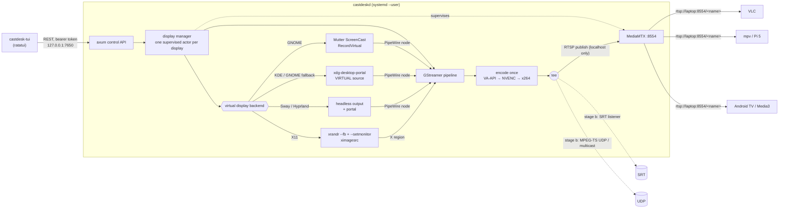

# CastDesk

Add virtual extra displays to a Linux laptop and stream each one to many LAN
receivers at once: VLC, mpv / Raspberry Pi, Android TV, and a custom Media3 app.
It's all Rust: `castdeskd` (daemon) + `castdesk-tui` (terminal UI), with a GTK
widget and the soft remote coming in later stages.

> **Status: stage (a) — virtual display + RTSP stream + TUI.**
> SRT/UDP fan-out, audio, latency overlay, GUI and the soft remote are next
> (see [Roadmap](#roadmap)).



## Why these choices

- **Rust daemon.** It ships as one binary with no Python/PyGObject version
  mismatch across distros. `gstreamer-rs`, `zbus` and `ashpd` are maintained
  and complete. Video never passes through our code (it stays in GStreamer's C
  threads), so the language only affects control logic. The cost: there's no
  Rust Android TV Remote v2 library, so stage (d) implements that protocol
  itself.
- **One encode per display, then `tee`.** Destinations are branches after the
  encoder. Adding or removing one never re-encodes or restarts the capture.
- **MediaMTX for RTSP.** It handles unlimited readers, UDP+TCP transports and
  per-reader RTCP. Writing an RTSP server ourselves would be strictly worse.
  castdeskd runs it as a supervised child and only localhost may publish, so
  nobody on the LAN can hijack a path.
- **Stable encoder output.** CBR, no B-frames, 1 s GOP, `config-interval=-1`
  (SPS/PPS on every keyframe), so a receiver joining mid-stream starts within
  about 1 s.

### Virtual display backends (picked at runtime)

| Session | Backend | How | Trade-offs |
|---|---|---|---|
| GNOME Wayland | `mutter` | `org.gnome.Mutter.ScreenCast` `RecordVirtual` over D-Bus | Best. No dialog; the size you choose *is* the monitor size. The monitor lives as long as the stream. Some locked-down GNOME builds deny this private API (AccessDenied); then `auto` falls back to `portal`. Placement is set in GNOME Settings → Displays for now. |
| KDE Plasma 6 Wayland (and GNOME fallback) | `portal` | xdg-desktop-portal ScreenCast, source type **VIRTUAL** | Standard API. One permission dialog the first time; after that a restore token (in `~/.local/state/castdesk/portal-tokens.json`) makes it silent. The compositor decides the initial mode; we scale to your resolution. |
| Sway / Hyprland | `wlroots` | `swaymsg create_output` / `hyprctl output create headless`, then portal MONITOR capture | Exact mode and position control. xdg-desktop-portal-wlr shows an output chooser the first time (pick `HEADLESS-n`). |
| X11 (any WM) | `x11` | `xrandr --fb` grows the root window; `xrandr --setmonitor CastDesk-<name> … none` declares a RandR monitor on the new area; `ximagesrc` captures it | Needs no driver. Right-of / below only. WMs must honour RandR 1.5 monitors (GNOME/KDE/XFCE/i3 do). The area isn't scanned out, so capture uses CPU copies. |
| any | `evdi` | DisplayLink's evdi kernel module creates a real DRM connector | **Stage (b+), needs root + DKMS** (and MOK signing with Secure Boot). Only if none of the above work for you. |
| headless | `test` | SMPTE bars + running clock | For verifying the network path without touching your desktop. |

Capture is PipeWire (`pipewiresrc`) on Wayland and `ximagesrc` on X11.
Screencasts are damage-driven, so on a static desktop `keepalive-time=500`
re-sends the last frame and receivers never stall.

**HDCP/DRM-protected video** (Netflix in some browsers, Blu-ray players) shows
as black in any screencast. That's by design and CastDesk doesn't try to get
around it.

## Install

```bash
git clone https://github.com/zed0x5f/jc-tv-broadcast && cd jc-tv-broadcast
packaging/install.sh --deps        # --deps uses sudo for distro packages; omit if you have them
systemctl --user start castdeskd
castdesk-tui
```

`install.sh` builds release binaries into `~/.local/bin`, downloads
**MediaMTX v1.21.3** into `~/.local/share/castdesk/bin/` (verified against the
release's `checksums.sha256`), and installs and enables the
`castdeskd.service` user unit plus a desktop entry. Nothing else needs root.
Requirements: Rust ≥ 1.85, GStreamer ≥ 1.22, MediaMTX ≥ 1.12.

`castdeskd doctor` prints the detected session, the backend order, which
encoders actually work (each is probed with a real 5-frame encode), and any
missing GStreamer elements.

Config lives in `~/.config/castdesk/config.toml`. Displays you add in the TUI
are saved there and recreated on every daemon start:

```toml
[daemon]
listen = "127.0.0.1:7650"   # control API: keep on loopback
advertise_host = ""         # IP/hostname shown in URLs; empty = auto-detect LAN IP

[mediamtx]
managed = true              # false = use your own RTSP server on rtsp_port
rtsp_port = 8554

[[display]]
name = "tv1"                # → rtsp://<laptop>:8554/tv1
backend = "auto"            # auto | mutter | portal | wlroots | x11 | test
placement = "right-of"      # right-of | left-of | above | below
width = 1920
height = 1080
fps = 60
bitrate_kbps = 12000
codec = "h264"              # h264 | h265
encoder = "auto"            # auto | vaapi | nvenc | software
gop_seconds = 1.0
```

## Using the TUI

`castdesk-tui` (or "CastDesk" in your app launcher):

| Key | Action |
|---|---|
| `a` | add a display: name, resolution, fps, bitrate, codec, encoder, backend, placement |
| `↑↓` / `j k` | select |
| `c` | copy the RTSP URL (wl-copy / xclip / OSC 52) |
| `r` | restart: recreates the virtual monitor, and retries a failed one |
| `d` | remove (asks first) |
| `s` / `S` | start / stop the daemon (`systemctl --user`, or a background process in a dev checkout) |
| `l` | daemon logs (`journalctl --user -u castdeskd`) |
| `q` | quit the TUI (streams keep running) |

The detail pane shows state, backend/output, encoder, live bitrate, fps,
dropped frames, RTSP client count, a 2-minute bitrate sparkline, and
copy-paste player commands.

## Stage (a): test it

**1. Network path, no desktop involved.**

```bash
scripts/selftest-stage-a.sh          # uses ~/.local/share/castdesk/bin/mediamtx
```

Success is nine `PASS` lines ending in `stage (a) self-test OK`. It uses its
own ports (17650/18554), so it can run next to your real daemon.

**2. A real virtual monitor.**

```bash
systemctl --user start castdeskd
castdesk-tui            # a → Enter (defaults: tv1, 1920x1080@60, auto backend)
```

Success looks like this:
- **GNOME:** a new monitor appears in Settings → Displays right away, and you
  can drag windows onto it.
- **KDE:** you approve the screencast dialog once, then a new output appears
  in System Settings → Display.
- **Sway:** pick `HEADLESS-1` in the chooser, and `swaymsg -t get_outputs`
  lists it.
- **X11:** `xrandr --listmonitors` shows `CastDesk-tv1`.
- **In the TUI:** state is `running`, fps is close to your setting while
  something moves, and bitrate is near 12 Mb/s on busy content (CBR pads, so
  it stays close even when the screen is static).

**3. Watch it from another machine** (or the laptop itself).
`<laptop>` is the IP the TUI shows:

```bash
vlc --network-caching=200 rtsp://<laptop>:8554/tv1
mpv --profile=low-latency --untimed --rtsp-transport=udp rtsp://<laptop>:8554/tv1
ffplay -fflags nobuffer -flags low_delay -framedrop rtsp://<laptop>:8554/tv1
ffprobe -v error -show_entries stream=codec_name,width,height,has_b_frames rtsp://<laptop>:8554/tv1
```

`ffprobe` should print `h264`, `1920`, `1080` and `has_b_frames=0`. The
TUI's client count goes up for each viewer.

**4. Resilience.** `pkill mediamtx` makes the display go `restarting` and
come back to `running` within about 3 s. Viewers reconnect: mpv/ffplay do it
on their own; VLC needs a replay.

## Setup notes per desktop

- **GNOME (Wayland):** nothing extra. If the log says `AccessDenied` on
  `CreateSession`, set `backend = "portal"` (GNOME 44+). The GNOME
  screen-sharing indicator in the top bar stops a stream if clicked; CastDesk
  then recreates the display.
- **KDE Plasma 6:** needs `xdg-desktop-portal-kde`. To re-prompt, delete the
  entry in `~/.local/state/castdesk/portal-tokens.json`.
- **Sway:** the user unit needs the session environment. Add to your sway config:
  `exec systemctl --user import-environment WAYLAND_DISPLAY SWAYSOCK XDG_CURRENT_DESKTOP && dbus-update-activation-environment --systemd WAYLAND_DISPLAY SWAYSOCK XDG_CURRENT_DESKTOP`.
  To skip the output chooser, put this in
  `~/.config/xdg-desktop-portal-wlr/config`:
  `[screencast]` / `chooser_type=none` / `output_name=HEADLESS-1`.
- **Hyprland:** same environment import (`exec-once`). `xdg-desktop-portal-hyprland` provides the picker.
- **X11:** needs `xrandr` (x11-xserver-utils). If your WM ignores RandR
  monitors, windows can't be maximised onto the new area. Use the evdi
  backend (coming later) in that case.

## Troubleshooting

| Symptom | Fix |
|---|---|
| Receivers can't connect | Open the firewall: **TCP 8554** (RTSP) and **UDP 8000–8001** (RTP/RTCP for UDP readers). `sudo ufw allow 8554/tcp && sudo ufw allow 8000:8001/udp` or `sudo firewall-cmd --add-port=8554/tcp --add-port=8000-8001/udp --permanent && sudo firewall-cmd --reload`. If UDP is blocked, players fall back to TCP (`--rtsp-transport=tcp`). |
| URL shows the wrong IP | Set `[daemon] advertise_host = "192.168.1.20"` (or `laptop.local`). |
| `no working H.264 encoder` | Run `castdeskd doctor`. Intel: `intel-media-va-driver-non-free`; AMD: `mesa-va-drivers` (Fedora: `mesa-va-drivers-freeworld` from RPM Fusion); software: `gstreamer1.0-plugins-ugly`. Check `vainfo` lists `VAProfileH264*: VAEntrypointEncSlice`. |
| **NVIDIA** | Needs the proprietary driver ≥ 535 and `nvh264enc` (gst-plugins-bad, built with nvcodec). Consumer GPUs limit concurrent NVENC sessions (driver-dependent, typically 5–8); if a display keeps restarting with an NVENC error, give it `encoder = "software"`. On Wayland, use driver ≥ 555 for working PipeWire DMA-BUF screencasts; on older drivers GNOME screencasts can be black. Set `encoder = "software"` to rule NVENC out. |
| Portal dialog every time | Your portal backend doesn't support persistence (xdg-desktop-portal < 1.12, or xdpw < 0.7). Upgrade it. |
| Black stream | Protected content (HDCP/DRM, see above), or the NVIDIA + old-driver issue above. Try `backend = "test"` to separate the network side from capture. |
| `port 8554 already in use` | Another RTSP server is running. Stop it, or set `[mediamtx] managed = false` to use it. |
| High `dropped` count | The encoder can't keep up (common with software encoding at 1080p60). Use a hardware encoder, or lower fps/resolution. |
| Stuttery on Wi-Fi receivers | Lower `bitrate_kbps`. SRT (stage b) is the better transport for unreliable links. |

Multicast notes (IGMP snooping, switch configuration) arrive with the UDP
destination in stage (b).

## Repository layout

```
crates/castdesk-core   config, API types, HTTP client (shared by daemon + all UIs)
crates/castdeskd       daemon: session detection, display backends, encoders, pipelines, MediaMTX, API
crates/castdesk-tui    ratatui front end
packaging/             install.sh, systemd user unit, .desktop file
scripts/               selftest-stage-a.sh (headless end-to-end check)
```

Development: `cargo test --workspace` (29 tests; the GStreamer ones need
x264enc/rtspclientsink installed), `cargo clippy --workspace --all-targets`.

### Control API (localhost)

The token is in `$XDG_RUNTIME_DIR/castdesk/token` (mode 0600, regenerated
on every start).

```bash
T=$(cat $XDG_RUNTIME_DIR/castdesk/token)
curl -H "Authorization: Bearer $T" localhost:7650/api/v1/system
curl -H "Authorization: Bearer $T" localhost:7650/api/v1/displays
curl -H "Authorization: Bearer $T" -XPOST localhost:7650/api/v1/displays -H 'content-type: application/json' -d '{"name":"tv2","width":1280,"height":720,"fps":30}'
curl -H "Authorization: Bearer $T" -XPOST localhost:7650/api/v1/displays/tv2/restart
curl -H "Authorization: Bearer $T" -XDELETE localhost:7650/api/v1/displays/tv2
```

## Roadmap

- [x] **(a)** virtual display (Mutter / portal / wlroots / X11) → one encode → RTSP via MediaMTX; health monitoring + auto-restart; TUI
- [ ] **(b)** SRT listener + MPEG-TS UDP unicast/multicast branches, toggled live with no encoder restart; audio (PipeWire sink monitor → AAC/Opus); latency-test overlay; Mutter placement via DisplayConfig; evdi backend
- [ ] **(c)** GTK4 widget + tray: destination toggles, receiver discovery (mDNS + ADB), "Send to…"
- [ ] **(d)** soft remote: ADB → Android TV Remote v2 (own Rust implementation) → CastDesk WebSocket protocol (`docs/control-protocol.md`) + Kotlin/Media3 stub; optional CEC
