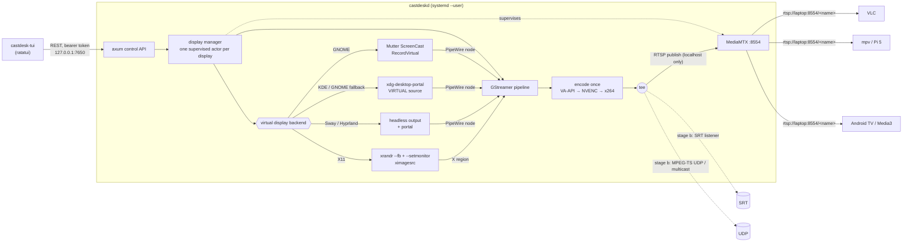

# CastDesk

Add virtual extra displays to a Linux laptop and stream each one to many LAN
receivers at once: VLC, mpv / Raspberry Pi, Android TV, and a custom Media3 app.
It's all Rust: `castdeskd` (daemon) + `castdesk-tui` (terminal UI), with the
soft remote coming in a later stage.

> **Status: stage (a) — virtual display + RTSP stream + TUI.**
> Only the headless path has been tested end to end; the real desktop backends
> and hardware encoders have not (see [Test status](#test-status)).
> SRT/UDP fan-out, audio, latency overlay and the soft remote are stubbed out
> and next (see [Roadmap](#roadmap)).



## Why these choices

- **Rust daemon.** It ships as one binary with no Python/PyGObject version
  mismatch across distros. `gstreamer-rs`, `zbus` and `ashpd` are maintained
  and complete. Video never passes through our code (it stays in GStreamer's C
  threads), so the language only affects control logic. The cost: there's no
  Rust Android TV Remote v2 library, so stage (c) implements that protocol
  itself.
- **One encode per display, then `tee`.** Destinations are branches after the
  encoder. Adding or removing one never re-encodes or restarts the capture.
- **MediaMTX for RTSP.** It handles unlimited readers, UDP+TCP transports and
  per-reader RTCP. Writing an RTSP server ourselves would be strictly worse.
  castdeskd runs it as a supervised child and only localhost may publish, so
  nobody on the LAN can hijack a path.
- **Stable encoder output.** CBR, no B-frames, 1 s GOP, `config-interval=-1`
  (SPS/PPS on every keyframe), so a receiver joining mid-stream starts within
  about 1 s. Keyframes are also forced by wall-clock time, because a static
  screencast sends only 1-2 frames a second: on a static GNOME desktop a
  GStreamer receiver joined in about 2 s (ffmpeg-based players take ~7 s
  to analyse such a slow stream).

### Virtual display backends (picked at runtime)

| Session | Backend | How | Trade-offs |
|---|---|---|---|
| GNOME Wayland | `mutter` | `org.gnome.Mutter.ScreenCast` `RecordVirtual` over D-Bus | Best. No dialog; the size you choose *is* the monitor size. The monitor lives as long as the stream. Some locked-down GNOME builds deny this private API (AccessDenied); then `auto` falls back to `portal`. Placement is set in GNOME Settings → Displays for now. |
| KDE Plasma 6 Wayland (and GNOME fallback) | `portal` | xdg-desktop-portal ScreenCast, source type **VIRTUAL** | Standard API. One permission dialog the first time; after that a restore token (in `~/.local/state/castdesk/portal-tokens.json`) makes it silent. The compositor decides the initial mode; we scale to your resolution. |
| Sway / Hyprland | `wlroots` | `swaymsg create_output` / `hyprctl output create headless`, then portal MONITOR capture | Exact mode and position control. xdg-desktop-portal-wlr shows an output chooser the first time (pick `HEADLESS-n`). |
| X11 (any WM) | `x11` | `xrandr --fb` grows the root window; `xrandr --setmonitor CastDesk-<name> … none` declares a RandR monitor on the new area; `ximagesrc` captures it | Needs no driver. Right-of / below only. WMs must honour RandR 1.5 monitors (GNOME/KDE/XFCE/i3 do). The area isn't scanned out, so capture uses CPU copies. |
| any | `evdi` | DisplayLink's evdi kernel module creates a real DRM connector | **Stub, planned for stage (b).** Rejected as not implemented today. Will need root + DKMS (and MOK signing with Secure Boot). Only if none of the above work for you. |
| headless | `test` | SMPTE bars + running clock | For verifying the network path without touching your desktop. |

Capture is PipeWire (`pipewiresrc`) on Wayland and `ximagesrc` on X11.
Screencasts are damage-driven, so on a static desktop `keepalive-time=500`
re-sends the last frame and receivers never stall.

**HDCP/DRM-protected video** (Netflix in some browsers, Blu-ray players) shows
as black in any screencast. That's by design and CastDesk doesn't try to get
around it.

## Install

```bash
git clone https://github.com/zed0x5f/jc-tv-broadcast && cd jc-tv-broadcast
packaging/install.sh               # run from your desktop session, as your user (not sudo)
systemctl --user start castdeskd
castdesk-tui
```

Dependencies are **detected at install time, on your machine**. The
installer detects your session (Wayland/X11, GNOME/KDE/Sway), GPU and
driver. It probes everything that applies, maps what's missing to packages
your apt sources actually offer, shows the `sudo apt-get install …` line and
asks first, then re-probes. Then it builds with whichever Rust toolchain
qualifies (Ubuntu 24.04's apt `cargo-1.91` works; rustup isn't needed),
downloads **MediaMTX v1.21.3** (pinned, sha256-verified) into
`~/.local/share/castdesk/bin/`, and installs the `castdeskd.service` user unit
and a desktop entry. sudo is used only for apt.
See [docs/dependencies.md](docs/dependencies.md) for how it works.

```bash
packaging/install.sh --check-only  # just report what's missing
packaging/install.sh --yes         # no prompts
packaging/install.sh --with-evdi   # include the optional evdi kernel module (the evdi backend is still a stub)
castdesk-deps                      # re-check later (new GPU/driver/desktop); -v shows skipped items
castdesk-deps --session x11 --gpu nvidia   # check for a different setup, e.g. over SSH
```

Minimums: Rust 1.91, GStreamer 1.22, MediaMTX 1.12, Python 3.11 (for the
checker). `castdeskd doctor` complements it with real 5-frame test encodes on
every encoder.

Config lives in `~/.config/castdesk/config.toml`. Displays you add in the TUI
are saved there and recreated on every daemon start:

```toml
[daemon]
listen = "127.0.0.1:7650"   # control API: keep on loopback
advertise_host = ""         # IP/hostname shown in URLs; empty = auto-detect LAN IP

[mediamtx]
managed = true              # false = use your own RTSP server on rtsp_port
rtsp_port = 8554
hls = false                 # also serve HLS on :8888 (browsers, TVs without RTSP)
webrtc = false              # also serve WebRTC on :8889 (browsers)

[[display]]
name = "tv1"                # → rtsp://<laptop>:8554/tv1
backend = "auto"            # auto | mutter | portal | wlroots | x11 | test
placement = "right-of"      # right-of | left-of | above | below
width = 1920
height = 1080
fps = 60
bitrate_kbps = 12000
codec = "h264"              # h264 (plays everywhere) | h265 (many TVs/browsers can't)
encoder = "auto"            # auto | vaapi | nvenc | software
gop_seconds = 1.0
```

Stage (b) settings already parse but are **rejected as not implemented**, so
they can't silently do nothing: `destinations = [...]` (SRT/UDP), `audio = true`,
`latency_overlay = true` and `backend = "evdi"`. A config file that contains
any of them stops the daemon from starting, with an error that names the
setting.

## Using the TUI

`castdesk-tui` (or "CastDesk" in your app launcher):

| Key | Action |
|---|---|
| `a` | add a display: name, resolution, fps, bitrate, codec, encoder, backend, placement |
| `↑↓` / `j k` | select |
| `c` | copy the RTSP URL (wl-copy / xclip / OSC 52) |
| `r` | restart: recreates the virtual monitor, and retries a failed one |
| `d` | remove (asks first) |
| `s` / `S` | start / stop the daemon (`systemctl --user`, or a background process in a dev checkout) |
| `l` | daemon logs (`journalctl --user -u castdeskd`) |
| `q` | quit the TUI (streams keep running) |

The detail pane shows state, backend/output, encoder, live bitrate, fps,
dropped frames, RTSP client count, a 2-minute bitrate sparkline, and
copy-paste player commands.

## Stage (a): test it

**1. Network path, no desktop involved.**

```bash
scripts/selftest-stage-a.sh          # uses ~/.local/share/castdesk/bin/mediamtx
```

Success is thirteen `PASS` lines ending in `stage (a) self-test OK` (one
`WARN` about colour tags is expected with `vah264enc`, see
[docs/receivers.md](docs/receivers.md)). It uses its own ports (17650/18554/
18888/18889), so it can run next to your real daemon. `ENCODER=software`
forces x264enc (also `vaapi`, `nvenc`).

**2. A real virtual monitor.**

```bash
systemctl --user start castdeskd
castdesk-tui            # a → Enter (defaults: tv1, 1920x1080@60, auto backend)
```

Success looks like this:
- **GNOME:** a new monitor appears in Settings → Displays right away, and you
  can drag windows onto it.
- **KDE:** you approve the screencast dialog once, then a new output appears
  in System Settings → Display.
- **Sway:** pick `HEADLESS-1` in the chooser, and `swaymsg -t get_outputs`
  lists it.
- **X11:** `xrandr --listmonitors` shows `CastDesk-tv1`.
- **In the TUI:** state is `running`, fps is close to your setting while
  something moves, and bitrate is near 12 Mb/s on busy content. On a static
  screen both drop to almost nothing (a few fps from the keepalive, a few kb/s),
  since screencasts only deliver frames on change. That's normal.

**3. Watch it from another machine** (or the laptop itself).
`<laptop>` is the IP the TUI shows:

```bash
vlc --rtsp-tcp --network-caching=200 rtsp://<laptop>:8554/tv1     # needs VLC's live555 module, see below
mpv --profile=low-latency --untimed --rtsp-transport=tcp rtsp://<laptop>:8554/tv1
ffplay -rtsp_transport tcp -fflags nobuffer -flags low_delay -framedrop rtsp://<laptop>:8554/tv1
ffprobe -v error -show_entries stream=codec_name,width,height,has_b_frames rtsp://<laptop>:8554/tv1
```

`ffprobe` should print `h264`, `1920`, `1080` and `has_b_frames=0`. The
TUI's client count goes up for each viewer. TCP is the safe choice on Wi-Fi
and through firewalls. Drop the flag on a wired LAN for slightly lower latency.
Which players and TVs work, and the HLS/WebRTC fallbacks:
[docs/receivers.md](docs/receivers.md).

**4. Resilience.** `pkill mediamtx` makes the display go `restarting` and
come back to `running` within about 7 s. Viewers reconnect: mpv/ffplay do it
on their own; VLC needs a replay.

## Test status

What has actually been run, as of this commit. Each source file's header
comment says the same thing for that file.

| Area | Tested | Not tested |
|---|---|---|
| Config, validation, stage (b) stub rejection | unit tests | — |
| Session detection | unit tests (synthetic GNOME/KDE/Sway/X11/headless env) | inside a real desktop session |
| `mutter` backend | by hand on GNOME (Wayland), Ubuntu 26.04: monitor appears, 1080p30 stream decodes over RTSP/UDP, recreated from config on start | AccessDenied → `portal` fallback; window moved onto it under load |
| `portal` backend | — | **never run** against KDE or GNOME |
| `wlroots` / `x11` backends | unit tests for output parsing and placement math | **never run** against Sway, Hyprland or an X server |
| `test` backend → encoder → MediaMTX → RTSP/HLS/WebRTC | `scripts/selftest-stage-a.sh`: all 13 checks pass on an Ubuntu 26.04 Intel laptop (GStreamer 1.28.2, MediaMTX v1.21.3) with both `vah264enc` (`auto`; warns: no colour tags) and `x264enc` (`ENCODER=software`). The earlier 9-check version also passed in an Ubuntu 24.04 container (x264enc, no GPU). | the 13-check version on 24.04; WebRTC media (only the player page is fetched) |
| Encoders | x264enc/x265enc probe + encode; selection logic unit-tested; Intel Comet Lake: vah264enc streams, vah265enc probes OK, vah264lpenc rejected (no CBR in low-power mode) | NVENC, AMD VA-API |
| Daemon supervision | self-test, and by hand on GNOME: MediaMTX kill → back to `running` in ~7 s; RTSP client count; 4 displays at once; 3 viewers on one display | recreating the virtual display after repeated failures; the stall detector (added after an intermittent freeze); `restart` endpoint |
| Control API | self-test: 401 without token, add/get/delete display | `/system`, `/health`, list, `restart` |
| TUI | rendering + add form (ratatui TestBackend, canned data) | against a live daemon; start/stop daemon, logs, clipboard |
| Dependency checker | 19 Python tests on faked machines; `install.sh` run end to end on Ubuntu 26.04 (GNOME, Intel) | Ubuntu 24.04, KDE, Sway, NVIDIA machines |
| Receivers | ffprobe/ffmpeg over RTSP TCP and UDP, and over HLS (self-test, which also checks profile, level ≤ 4.2, yuv420p and colour tags); GStreamer rtspsrc + vah264dec and ffmpeg over the LAN address; join time on a static screen measured | VLC with live555 (Ubuntu's VLC can't play RTSP), mpv, Raspberry Pi, Android TV, another machine on the LAN |
| Stage (b)/(c) stubs | each stub's "not implemented" error | — (no functionality yet) |

## Setup notes per desktop

- **GNOME (Wayland):** nothing extra. If the log says `AccessDenied` on
  `CreateSession`, set `backend = "portal"` (GNOME 44+). The GNOME
  screen-sharing indicator in the top bar stops a stream if clicked; CastDesk
  then recreates the display.
- **KDE Plasma 6:** needs `xdg-desktop-portal-kde`. To re-prompt, delete the
  entry in `~/.local/state/castdesk/portal-tokens.json`.
- **Sway:** the user unit needs the session environment. Add to your sway config:
  `exec systemctl --user import-environment WAYLAND_DISPLAY SWAYSOCK XDG_CURRENT_DESKTOP && dbus-update-activation-environment --systemd WAYLAND_DISPLAY SWAYSOCK XDG_CURRENT_DESKTOP`.
  To skip the output chooser, put this in
  `~/.config/xdg-desktop-portal-wlr/config`:
  `[screencast]` / `chooser_type=none` / `output_name=HEADLESS-1`.
- **Hyprland:** same environment import (`exec-once`). `xdg-desktop-portal-hyprland` provides the picker.
- **X11:** needs `xrandr` (x11-xserver-utils). If your WM ignores RandR
  monitors, windows can't be maximised onto the new area. Use the evdi
  backend (coming later) in that case.

## Troubleshooting

| Symptom | Fix |
|---|---|
| VLC: "unable to open the MRL" | Your VLC has no RTSP support. Debian/Ubuntu builds don't ship VLC's live555 module (Ubuntu 26.04's archive has no live555 at all), so VLC falls back to modules that can't talk to MediaMTX (the log shows `satip` and `access_realrtsp`). Use the VLC snap or Flatpak, which bundle it (`sudo snap install vlc`), or another player: `ffplay`, `mpv`, `gst-play-1.0`. |
| A TV or app connects but shows nothing | Usually the codec: switch the display to H.264, and keep it at 1080p60 or below (H.264 level 4.2). The TUI shows a yellow `Note` when the settings may be too much for some receivers. If the player can't do RTSP at all, enable `hls` or `webrtc` (see [docs/receivers.md](docs/receivers.md)). |
| Receivers can't connect | `castdeskd doctor` lists every port to open. Open the firewall: **TCP 8554** (RTSP) and **UDP 8000–8001** (RTP/RTCP for UDP readers). `sudo ufw allow 8554/tcp && sudo ufw allow 8000:8001/udp` or `sudo firewall-cmd --add-port=8554/tcp --add-port=8000-8001/udp --permanent && sudo firewall-cmd --reload`. If UDP is blocked, players fall back to TCP (`--rtsp-transport=tcp`). |
| URL shows the wrong IP | Set `[daemon] advertise_host = "192.168.1.20"` (or `laptop.local`). |
| `no working H.264 encoder` | Run `castdeskd doctor`. Intel: `intel-media-va-driver-non-free`; AMD: `mesa-va-drivers` (Fedora: `mesa-va-drivers-freeworld` from RPM Fusion); software: `gstreamer1.0-plugins-ugly`. Check `vainfo` lists `VAProfileH264*: VAEntrypointEncSlice`. |
| **NVIDIA** | Needs the proprietary driver ≥ 535 and `nvh264enc` (gst-plugins-bad, built with nvcodec). Consumer GPUs limit concurrent NVENC sessions (driver-dependent, typically 5–8); if a display keeps restarting with an NVENC error, give it `encoder = "software"`. On Wayland, use driver ≥ 555 for working PipeWire DMA-BUF screencasts; on older drivers GNOME screencasts can be black. Set `encoder = "software"` to rule NVENC out. |
| Portal dialog every time | Your portal backend doesn't support persistence (xdg-desktop-portal < 1.12, or xdpw < 0.7). Upgrade it. |
| Black stream | Protected content (HDCP/DRM, see above), or the NVIDIA + old-driver issue above. Try `backend = "test"` to separate the network side from capture. |
| `port 8554 already in use` | Another RTSP server is running. Stop it, or set `[mediamtx] managed = false` to use it. |
| High `dropped` count | The encoder can't keep up (common with software encoding at 1080p60). Use a hardware encoder, or lower fps/resolution. |
| Stuttery on Wi-Fi receivers | Lower `bitrate_kbps`. SRT (stage b) is the better transport for unreliable links. |

Multicast notes (IGMP snooping, switch configuration) arrive with the UDP
destination in stage (b).

## Repository layout

```
crates/castdesk-core   config, API types, HTTP client (shared by daemon + all UIs)
crates/castdeskd       daemon: session detection, display backends, encoders, pipelines, MediaMTX, API
crates/castdesk-tui    ratatui front end
packaging/             install.sh, deps.toml + castdesk-deps (runtime dependency detection),
                       systemd user unit, .desktop file
docs/                  dependencies.md, receivers.md, control-protocol.md (draft, stage c)
receivers/media3/      placeholder for the Android receiver app (stage c, no code yet)
scripts/               selftest-stage-a.sh (headless end-to-end check)
```

Stubs are marked `STUB (stage x)` in the code and return a "not implemented
yet" error: `destinations.rs`, `audio.rs`, `overlay.rs`, `display/evdi.rs`,
`MutterDisplay::apply_placement` (stage b), and `remote/` (stage c).

Development: `cargo test --workspace` (35 tests; the GStreamer ones need
x264enc/rtspclientsink installed), `python3 -m unittest discover -s packaging/tests`
(19 tests), `cargo clippy --workspace --all-targets`.

### Control API (localhost)

The token is in `$XDG_RUNTIME_DIR/castdesk/token` (mode 0600, regenerated
on every start).

```bash
T=$(cat $XDG_RUNTIME_DIR/castdesk/token)
curl -H "Authorization: Bearer $T" localhost:7650/api/v1/system
curl -H "Authorization: Bearer $T" localhost:7650/api/v1/displays
curl -H "Authorization: Bearer $T" -XPOST localhost:7650/api/v1/displays -H 'content-type: application/json' -d '{"name":"tv2","width":1280,"height":720,"fps":30}'
curl -H "Authorization: Bearer $T" -XPOST localhost:7650/api/v1/displays/tv2/restart
curl -H "Authorization: Bearer $T" -XDELETE localhost:7650/api/v1/displays/tv2
```

## Roadmap

- [x] **(a)** virtual display (Mutter / portal / wlroots / X11) → one encode → RTSP via MediaMTX; health monitoring + auto-restart; TUI. Code complete; only the headless path is tested (see [Test status](#test-status))
- [ ] **(b)** *(stubbed)* SRT listener + MPEG-TS UDP unicast/multicast branches, toggled live with no encoder restart; audio (PipeWire sink monitor → AAC/Opus); latency-test overlay; Mutter placement via DisplayConfig; evdi backend
- [ ] **(c)** *(stubbed)* soft remote: ADB → Android TV Remote v2 (own Rust implementation) → CastDesk WebSocket protocol (`docs/control-protocol.md`) + Kotlin/Media3 receiver (`receivers/media3/`); optional CEC

The GTK4 widget / tray stage was dropped. The TUI and the REST API are the
front ends.
